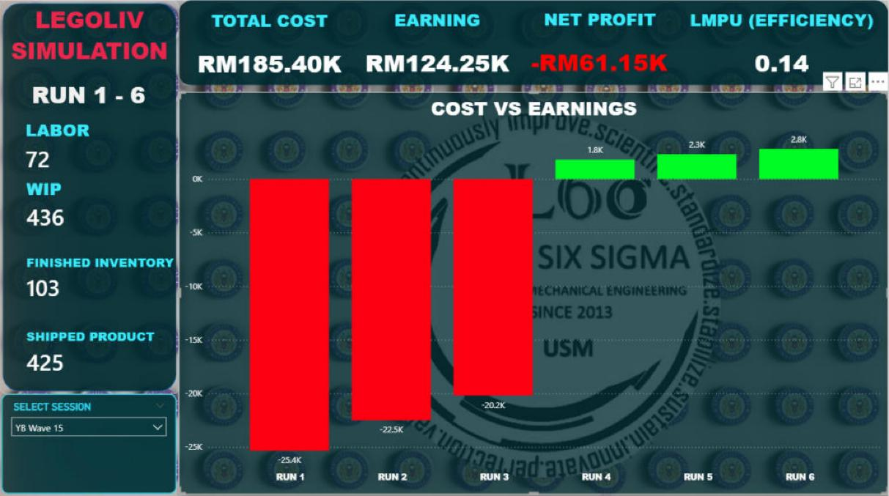

# Legoliv Data Logger

**Students type their Lego-simulation numbers into a Telegram bot, and a Power BI dashboard updates live.**

Built for the Lean Six Sigma "Legoliv" simulation at Universiti Sains Malaysia (School of Mechanical Engineering). Each class ("wave") keeps its own results, and the lecturer can fix mistakes from Telegram without touching the dashboard.



---

## How it works (in 30 seconds)

```
 Student (Telegram)  -->  Bot (legobot.py on the lecturer's PC)  -->  Power BI dashboard
   sends 4 numbers         works out cost, profit, LMPU                shows live charts
```

1. A group opens the bot, picks its **RUN** and **Group**, and sends four numbers: **A** people, **B** components (WIP), **C** finished units, **D** shipped units.
2. The bot calculates labour cost, inventory cost, earnings, profit and LMPU, then pushes one row to Power BI.
3. The dashboard shows totals and a Cost-vs-Earnings chart for the chosen **session** (wave).

## What is in this repository

| File / folder | What it is |
|---|---|
| `legobot.py` | The Telegram bot (all the logic). |
| `INSTALL.bat` | One-click installer for Python, Telegram Desktop, Power BI Desktop and the bot's libraries. |
| `START_BOT.bat` | Starts the bot. |
| `BUILD_EXE.bat` | Optional: builds `legobot.exe` so other PCs need no Python. |
| `config.ini.example` | Template for your private settings (token + Push URL). |
| `dashboard/Legoliv_Dashboard.pbix` | The Power BI dashboard design. |
| `docs/INSTALLATION.md` | Step-by-step install (what to click). |
| `docs/POWERBI_SETUP.md` | One-time Power BI setup (create the dataset, connect the dashboard). |
| `docs/USER_GUIDE.md` | Every Telegram button and Power BI control, explained. |

## Quick start

1. **Download** this repository (green **Code** button, then **Download ZIP**) and unzip it.
2. Double-click **`INSTALL.bat`**. It installs anything missing.
3. Follow **[docs/POWERBI_SETUP.md](docs/POWERBI_SETUP.md)** once (about 20 minutes).
4. Double-click **`START_BOT.bat`**. The first time, it asks for your **bot token** and **Push URL** and remembers them.
5. Open the bot in Telegram, press **Start**, choose the wave, and begin.

Full details: **[docs/INSTALLATION.md](docs/INSTALLATION.md)** and **[docs/USER_GUIDE.md](docs/USER_GUIDE.md)**.

> Each person who reuses this project needs their **own** bot (create it with `@BotFather` in Telegram) and their **own** Power BI streaming dataset. The token and Push URL are secrets: they live in `config.ini`, which is excluded from Git on purpose.

---

## Improvements over the original FYP version

The original bot asked the lecturer to delete all data between classes and to type settings into the code. This version fixes that.

| # | Improvement | Why it matters |
|---|---|---|
| 1 | **Sessions ("YB Wave XX")**: every row is stamped with a session name and time. A dropdown on the dashboard switches between waves. | Old classes are kept and never mixed with new ones. No more deleting data. |
| 2 | **Wave is chosen inside Telegram** (asks "Which wave?" after Start, or use `/session`). Only the number is typed; `YB Wave` is added automatically. | The lecturer only needs Telegram, not the black console window. |
| 3 | **Settings in `config.ini`** instead of inside the code; asked once, then remembered. | Safe to share the code; nothing secret in it; no re-pasting each time. |
| 4 | **Edit a wrong entry** from Telegram (`/manage`). Shows before/after profit, then confirms. | Fixes mistakes without the old "send negative numbers" trick. |
| 5 | **Delete an entry or remove a whole session** from Telegram. | Clean up test data in seconds. |
| 6 | **Automatic backups + Restore.** A copy of the ledger is saved before every change. | Removed the wrong thing? Press Restore. |
| 7 | **Dropdown hides removed sessions** (filter on a helper measure). | A removed class really disappears from the list. |
| 8 | **Commands work at any moment** (`/session`, `/manage`, `/start`), even in the middle of a menu. | No more "Please click the buttons provided" dead ends. |
| 9 | **Clear error messages** when Power BI rejects data or the network drops. | Easy to see what went wrong. |
| 10 | **One-click installer** and a start script. | A non-technical user can set it up. |
| 11 | **Optional admin PIN** for `/session` and `/manage`. | Students cannot rename or delete data. |
| 12 | **Styled session dropdown** matching the dashboard theme. | Looks consistent and professional. |

Calculations (labour, WIP, finished and shipped costs, selling prices per RUN, LMPU) are unchanged from the original.

## How editing and removing works (and its limits)

Power BI streaming datasets cannot delete or change single rows. So the bot keeps its own list of everything it sends (`ledger.json`). To "remove" an entry it sends the **same row with negative numbers**, so every total adds back to zero. An edit is a removal plus a corrected entry.

- Only entries sent by this bot version are tracked. Older rows cannot be edited from Telegram.
- Never clear `ledger.json` while data is still on the dashboard: the bot would lose the ability to cancel it.
- To wipe **everything**, turn **Historic data analysis** Off then On in Power BI (this deletes all rows permanently). Details are in the user guide.

## Tech

Python 3, [pyTelegramBotAPI](https://github.com/eternnoir/pyTelegramBot), `requests`, Power BI streaming dataset (Push URL), Power BI Desktop.

## Credits

Original simulation and dashboard: Lean Six Sigma, School of Mechanical Engineering, USM. Handover version, sessions, editing and installer improvements: Tuan Muhamad Amin Tuan Mustafa.

## License

MIT, see [LICENSE](LICENSE).
