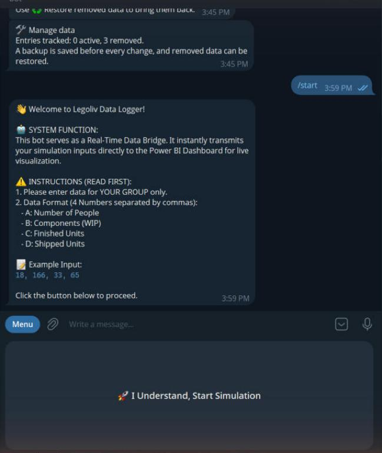
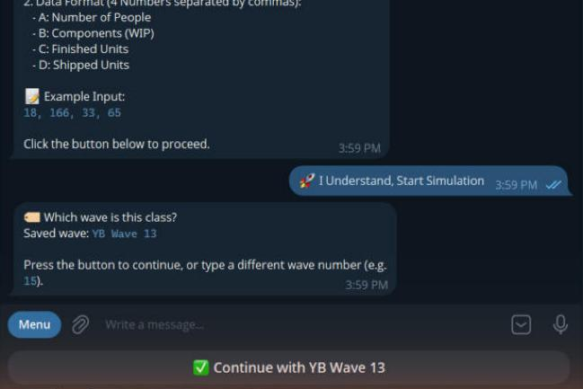
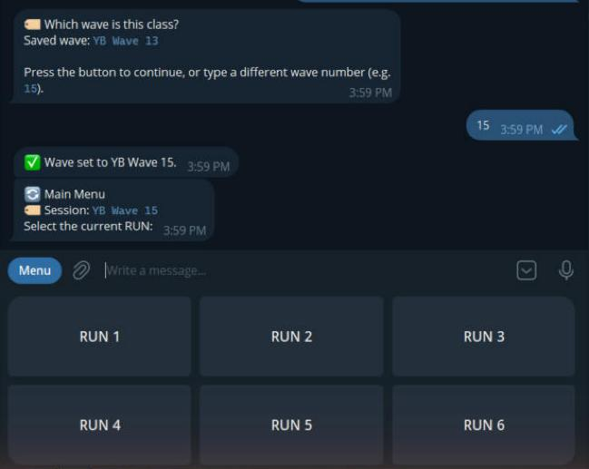
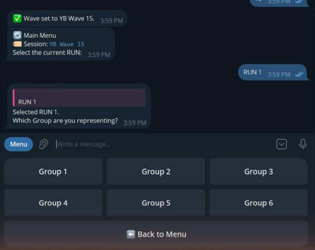
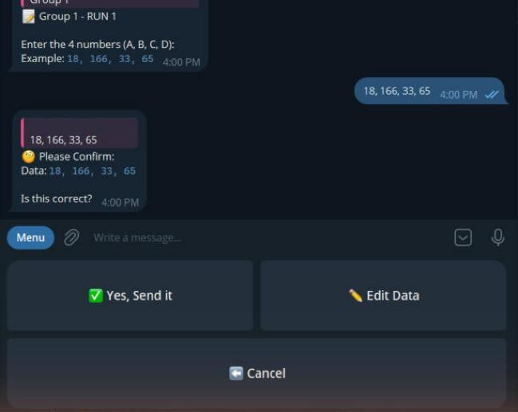
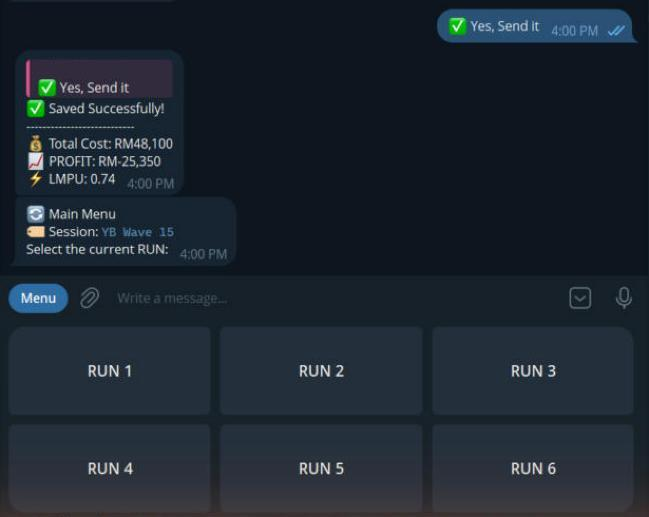
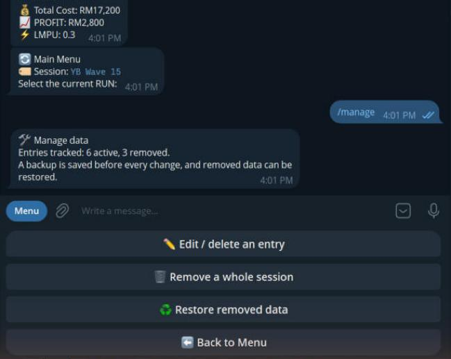
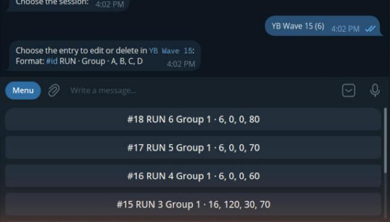
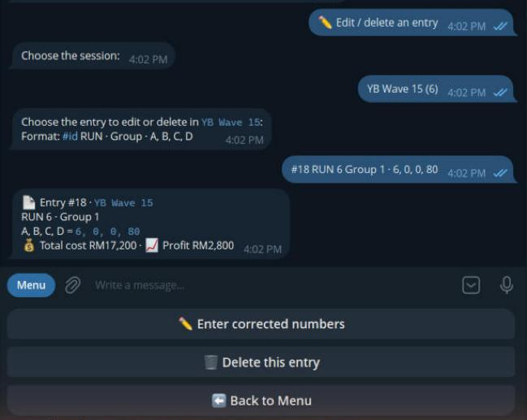
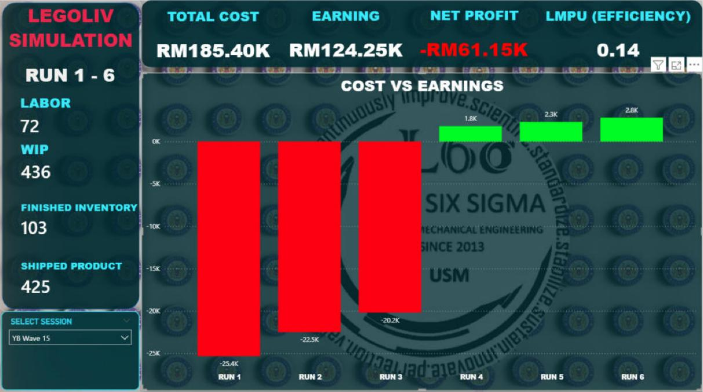

# User guide

How to run a class, button by button. The class bot is **t.me/L6SToolBot** (if you made your own bot, use its link).

## Before class (lecturer)

1. Double-click **`START_BOT.bat`** and wait for **BOT IS RUNNING**. Keep the window open.
2. Open the dashboard in Power BI (Desktop or app.powerbi.com).

## Telegram - what each button does

### 1. Welcome screen (`/start`)

| Button | What it does |
|---|---|
| **I Understand, Start Simulation** | Moves on to the wave question. |

### 2. Which wave?

| Button / action | What it does |
|---|---|
| **Continue with YB Wave XX** | Keeps the saved wave. |
| Type a number (for example `15`) | Changes the wave to **YB Wave 15** (YB = Yellow Belt, Wave = generation). |

Everything sent afterwards is saved under that wave. If an admin PIN is set, changing the wave asks for it.

### 3. Main menu

The menu shows the current **Session**. Press the **RUN** you are on (**RUN 1** to **RUN 6**). Selling prices follow the RUN (RUN 1-2: RM350, RUN 3: RM300, RUN 4-6: RM250).

### 4. Choose your group

| Button | What it does |
|---|---|
| **Group 1** to **Group 6** | Chooses which group you represent. |
| **Back to Menu** | Goes back to choose a different RUN. |

### 5. Send the four numbers

Type them separated by commas, in this order:

| Letter | Meaning | Example |
|---|---|---|
| A | Number of people | 18 |
| B | Components (WIP) | 166 |
| C | Finished units | 33 |
| D | Shipped units | 65 |

Example message: `18, 166, 33, 65`. Numbers cannot be negative. A wrong format is rejected with "Format Error" and you can try again.

### 6. Confirm

| Button | What it does |
|---|---|
| **Yes, Send it** | Sends the entry to Power BI. |
| **Edit Data** | Lets you type the four numbers again. |
| **Cancel** | Throws the entry away and returns to the menu. |

### 7. Saved

The bot replies with **Total Cost**, **Profit** and **LMPU** for that entry, then shows the main menu again for the next RUN.

## Telegram - lecturer commands

| Command | What it does |
|---|---|
| `/start` or `/help` | Shows the welcome screen. |
| `/session` | Asks for the wave number (type just the number). |
| `/manage` | Opens the data-management menu (below). |
| `/resetledger` | Hidden. Clears the bot's own list. Only after you wiped the dashboard yourself in Power BI. |

These commands work at any time, even in the middle of a menu.

### `/manage` - fix or remove data

| Button | What it does |
|---|---|
| **Edit / delete an entry** | Pick a session, then an entry. See below. |
| **Remove a whole session** | Removes every entry of one session (or **ALL sessions**) from the dashboard. Asks you to confirm. |
| **Restore removed data** | Brings removed entries back (one, or **Restore ALL removed**). |
| **Back to Menu** | Returns to the RUN menu. |

**Editing one entry**

Entries are listed as `#id RUN - Group - A, B, C, D`, newest first. Press one:

| Button | What it does |
|---|---|
| **Enter corrected numbers** | Type the right A, B, C, D. The bot shows *before and after* profit and asks **Yes, apply correction**. The old entry is cancelled and the corrected one is added. |
| **Delete this entry** | Removes that one entry (after confirmation). |
| **Back to Menu** | Cancels. |

**Safety net:** before every edit, delete, remove or restore, the bot saves a copy of its list in the `backups` folder and tells you the file name. Removed something by mistake? Press **Restore removed data**.

## Power BI - what each control does

| Part of the screen | What it does |
|---|---|
| **SELECT SESSION** dropdown | Chooses which wave to show. Only sessions that still have data are listed. |
| **Total cost / Earning / Net profit / LMPU** cards | Totals for the chosen session. Net profit is red when negative and green when positive. |
| **Left panel** (Labor, WIP, Finished, Shipped) | Totals of people and units for the chosen session. |
| **Cost vs Earnings** chart | One bar per RUN: green = profit, red = loss. |
| **Refresh** (Home ribbon in Desktop, or the refresh icon online) | Loads the newest entries. Click it after students send data. |
| **Publish** (Home ribbon) | Uploads your changed report to My workspace. |
| **Filters** pane | Do not change. It hides removed sessions in the dropdown. |

## After class

1. Close the bot window.
2. Leave **Historic data analysis** On. Old waves stay available in the dropdown.
3. To remove a wave: send `/manage`, then **Remove a whole session**, then refresh the dashboard.

## Rules to remember

- Run the bot on **one PC only**.
- Never turn Historic data analysis **Off** unless you want to delete **everything**.
- Do not delete `ledger.json` or the `backups` folder.
- Optional lock: add `admin_pin = 1234` to `config.ini` so only people who know the PIN can use `/session` and `/manage`.

## If something goes wrong

| Problem | What to do |
|---|---|
| Bot does not answer | Check the black window is open and the PC is online. Only one copy may run. |
| "Power BI did not accept the data" | The black window shows why. Usually the Push URL is wrong or a value name in the dataset is misspelled. |
| Dashboard shows old numbers | Check the Session dropdown, then press Refresh. |
| A removed session still shows in the dropdown | Press Refresh. If it persists, check the `Session Has Data` filter (see POWERBI_SETUP.md). |
| A group sent wrong numbers | `/manage`, **Edit / delete an entry**. |
